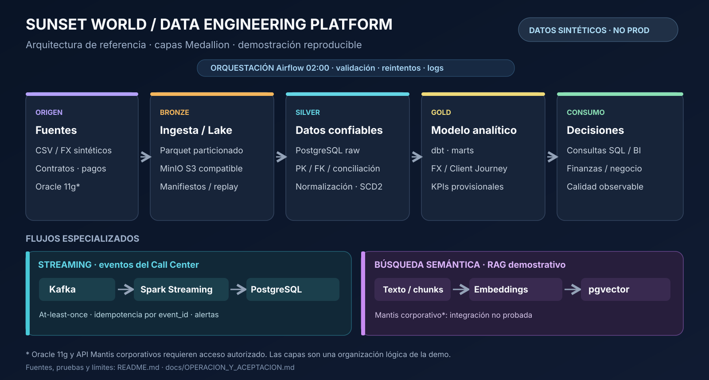
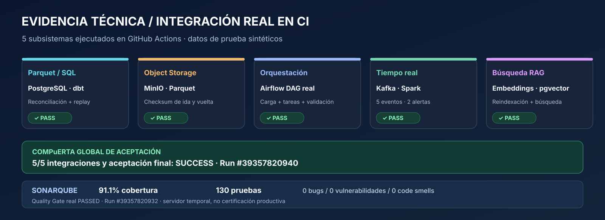

# Sunset World · Data Engineering Platform

**Examen técnico Data Engineer · solución reproducible con datos sintéticos.** Ingeniería de datos de extremo a extremo: ingesta, almacenamiento por capas, calidad, Data Warehouse, orquestación, streaming y búsqueda semántica.

> **Estado de la versión técnica anterior a la limpieza documental:** [GitHub Actions #39357820940](https://github.com/jairdiazrios95-web/sunset-world-data-platform/actions/runs/39357820940): **5/5 integraciones en PASS y aceptación final SUCCESS**. [SonarQube Community #39357820932](https://github.com/jairdiazrios95-web/sunset-world-data-platform/actions/runs/39357820932): **91.1% de cobertura**, **130 tests Pytest PASS**, **0 bugs**, **0 vulnerabilidades** y **0 code smells** reportados, **Quality Gate OK**. Los porcentajes pertenecen a esas ejecuciones, no certifican automáticamente futuros commits. El servidor SonarQube es temporal.

## Arquitectura · Bronze / Silver / Gold



**Origen / ingesta:** fuentes CSV/FX sintéticas y adaptador de lectura incremental Oracle 11g (sin conexión al Oracle corporativo), con extracciones paginadas, configuración y controles de origen.

**Bronze:** archivos Parquet particionados por año y mes, MinIO S3-compatible, manifiestos y conciliación de conteos. Publicación repetible y manejo explícito de reejecuciones.

**Silver:** aterrizaje `raw` en PostgreSQL, normalización, llaves PK/FK, rechazos controlados, integridad referencial y dimensiones con historia SCD tipo 2.

**Gold:** modelo estrella y *marts* dbt, vistas de ventas, FX y Client Journey. KPIs como VPG y conversión son **provisionales** hasta validación funcional del negocio.

**Procesos laterales:** Airflow 2.10.x orquesta las cargas; Kafka → Spark Structured Streaming → PostgreSQL procesa eventos con semántica *at-least-once* e idempotencia por `event_id`; el pipeline RAG prepara embeddings multilingües e índice pgvector. Mantis corporativo no está conectado.

## Evidencia verificable



| Componente | Evidencia |
|---|---|
| PostgreSQL, Parquet, dbt, modelo dimensional, replay | [CI integral #39357820940](https://github.com/jairdiazrios95-web/sunset-world-data-platform/actions/runs/39357820940) |
| MinIO · subida/descarga con checksum | [Misma aceptación](https://github.com/jairdiazrios95-web/sunset-world-data-platform/actions/runs/39357820940) |
| Airflow · DAG ejecutado sobre contenedores | [Misma aceptación](https://github.com/jairdiazrios95-web/sunset-world-data-platform/actions/runs/39357820940) |
| Kafka/Spark · procesamiento y alertas | [Misma aceptación](https://github.com/jairdiazrios95-web/sunset-world-data-platform/actions/runs/39357820940) |
| Embeddings/RAG · pgvector y replay | [Misma aceptación](https://github.com/jairdiazrios95-web/sunset-world-data-platform/actions/runs/39357820940) |
| Python, seguridad, cobertura y Quality Gate real | [SonarQube #39357820932](https://github.com/jairdiazrios95-web/sunset-world-data-platform/actions/runs/39357820932) |

La evidencia Kafka/Spark de esa ejecución incluye **5 eventos, 2 alertas y 5 filas persistidas sin duplicación tras el replay**. No se afirma garantía exactly-once distribuida.

**Estrés físico PostgreSQL separado:** [CI #39334943627](https://github.com/jairdiazrios95-web/sunset-world-data-platform/actions/runs/39334943627): **42,800,000 filas sintéticas** (9 M leads, 13.8 M pagos, 20 M comentarios), **436.102 segundos**, **0 huérfanos**, replay estable. Es una prueba de *PostgreSQL relacional*, **no** una carga de 42.8 M atravesando Oracle, Kafka, Spark, MinIO o RAG. Los JSON de prueba se guardan como *artifacts* de cada ejecución, no como reportes históricos versionados.

## Ejecutar y reproducir

Requisitos: Python 3.11; Docker y Docker Compose para pruebas de infraestructura. La reproducción de pruebas Python usa fixtures en `data/sample/`.

```bash
git clone https://github.com/jairdiazrios95-web/sunset-world-data-platform.git
cd sunset-world-data-platform
python -m pip install -r requirements.txt
python -m pytest -q tests
python -m sunset.cli audit --input data/sample
python -m sunset.quality --input data/sample --scope full --report reports/quality_local.json
python -m sunset.offline_demo --input data/sample --report reports/offline_demo_verified.json
```

Para los servicios, copiar `.env.example` a `.env`, sustituir contraseñas de ejemplo y consultar [el runbook vigente](docs/OPERACION_Y_ACEPTACION.md). Los resultados se escriben en `reports/` al ejecutar y no se versionan.

## Estructura actual

| Carpeta | Alcance |
|---|---|
| `sunset/`, `config/`, `data/sample/` | Generador y datos de prueba, contratos, auditoría, calidad, Parquet/MinIO |
| `oracle/` | Extracción incremental Oracle read-only (adaptador sin prueba corporativa) |
| `warehouse/`, `sql/`, `dbt/` | Carga, DW, SCD2, vistas y validaciones |
| `airflow/dags/` | Orquestación |
| `streaming/` | Kafka, Spark y reglas de alerta |
| `rag/` | Embeddings, pgvector y búsqueda |
| `tests/`, `stress/`, `scripts/` | Tests, carga sintética, validación de servicios |
| `notebooks/` | Notebook técnico |
| `.github/workflows/` | Pruebas CI y Quality Gate |
| `docs/` | Exclusivamente operación, criterios de SonarQube y diagramas de la solución vigente |

## Alcance, límites y decisiones

La solución implementa control por claves, conciliación, reintentos, particionado, comprobación de integridad y separación entre modelos de almacenamiento y consumo. El origen corporativo Oracle 11g, la API Mantis y las definiciones definitivas de VPG/conversión **no están disponibles**; se usan datos **sintéticos** y **no** se afirma validación de producción.

El repositorio contiene solamente **código, pruebas, configuración, fixtures y documentación técnica vigente**. El **PDF de respuestas abiertas**, el ZIP de entrega, la **presentación ejecutiva** y un posible **video** se preparan y entregan **por separado** conforme a las instrucciones del examen. No se incluyen en Git ni se comparte información corporativa.

Guías: [operación y aceptación](docs/OPERACION_Y_ACEPTACION.md) · [SonarQube real y excepciones revisadas](docs/SONARQUBE_EPHEMERAL.md).
